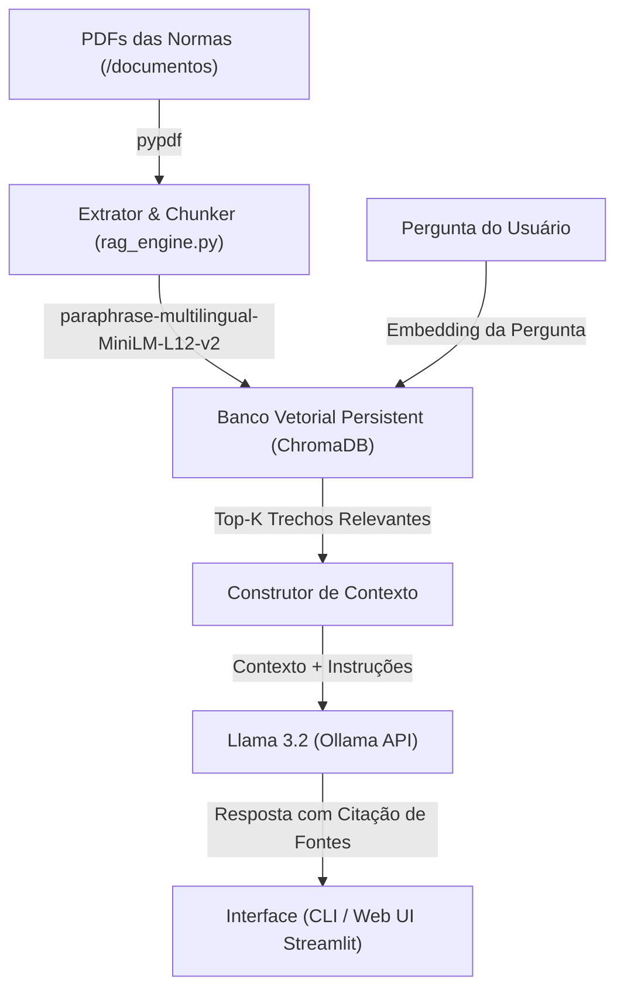

# RAG para Consulta de Normas e Resoluções com Llama 3.2

Sistema RAG (Retrieval-Augmented Generation) desenvolvido para busca semântica e respostas baseadas em normas institucionais, estatutos, regimentos e resoluções em formato PDF localizados em `/home/lucas/workspace/valhalla/documentos/`.

---

## 🏗 Arquitetura do Sistema



---

## 🚀 Como Usar

### 1. Indexar os Documentos
Antes da primeira consulta (ou sempre que adicionar novos PDFs em `documentos/`), execute:
```bash
./run.sh index
```

### 2. Interface Interativa via Terminal (CLI)
Para conversar interativamente via linha de comando:
```bash
./run.sh cli
```

### 3. Fazer uma Pergunta Direta no Terminal
```bash
./run.sh ask "Quais são os critérios de aprovação previstos na norma?"
```

### 4. Interface Web (Streamlit UI)
Para abrir a interface gráfica no navegador:
```bash
./run.sh ui
```

---

## ⚙️ Funcionalidades Principal

- **Citação Explícita de Fontes**: Cada resposta indica o nome exato do arquivo PDF, o número da página e o grau de relevância/similaridade.
- **Filtro por Categoria**: Permite filtrar as buscas por subpastas (`consad`, `estatuto`, `plano_gestao`, `regimento_geral`, `regimento_interno_reitoria`).
- **Modelo Local (Ollama Llama 3.2)**: Totalmente privado e executado na sua máquina sem enviar dados externamente.
